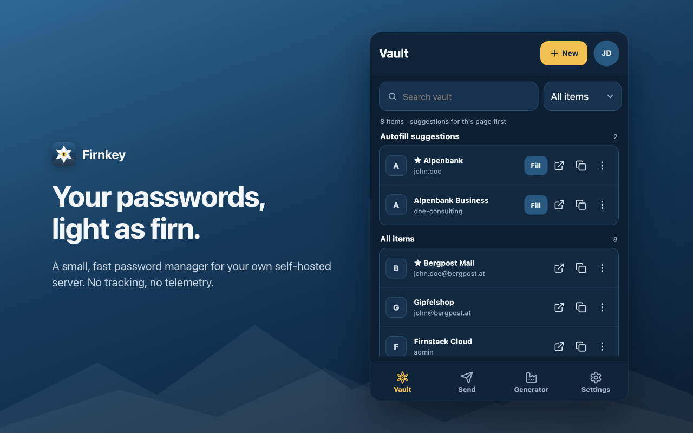

<p align="center">
  
</p>

<h1 align="center">Firnkey</h1>

<p align="center">
  A small, quiet password manager for Chrome that talks only to <b>your own server</b>.<br>
  English · Deutsch · GPL-3.0
</p>



Firnkey connects to a self-hosted password server that speaks the Bitwarden API and keeps the
browser side light: one Manifest V3 extension, no account with us, no analytics, and permissions
only when a feature needs them. Everything is encrypted and decrypted on your device.

The name comes from the Alps. *Firn* is old, packed snow on its way to becoming glacier ice: quiet,
solid and hard to reach. The edelweiß in the icon grows up there too, protected by where it lives.

> [!WARNING]
> Firnkey has not had an independent security audit yet. Try it with a test account first.

> [!NOTE]
> Firnkey is an independent project and is not affiliated with or endorsed by Bitwarden, Inc.
> "Bitwarden" is their trademark and appears here only to describe compatibility. Please report
> Firnkey problems in this repository, not to Bitwarden.

## What it does

**Sign in and unlock**
- Any server address, also behind a reverse-proxy path. PBKDF2 and Argon2id accounts, encryption v1
  and v2.
- Two-step login: authenticator app, email, YubiKey OTP, recovery code, security key (WebAuthn) and
  Duo.
- Lock after 1 minute to 24 hours, when the computer locks, when the browser closes, or only when you
  log out. Unlock with Touch ID or Windows Hello.
- Several accounts, on the same or different servers, with quick switching.

**On websites** (off until you turn on website integration)
- Suggestions right in the login field, plus fill with <kbd>Ctrl</kbd>+<kbd>Shift</kbd>+<kbd>L</kbd>
  (<kbd>⌘</kbd>+<kbd>Shift</kbd>+<kbd>L</kbd> on a Mac) or the right-click menu.
- Several accounts on one site: the account you pick on a username-only step comes first on the
  password step, and its password fills there by itself (can be turned off).
- Offers to save new logins and to update changed passwords.
- Cards (HTTPS pages only) and identities fill every field of a payment or address form from the
  field menu, including payment-provider iframes. The menu can also start a new card or identity
  from what the form holds, and a card or address you type and submit is offered for saving.
- Passkeys: create them on websites and sign in with them.
- One-time codes appear in code fields and fill automatically on the page after a login.
- Optional: answers the browser's own sign-in dialog (HTTP basic auth).
- Excluded domains where Firnkey stays silent.

**In the popup**
- Fast search, with logins for the current page on top and a match count on the toolbar icon.
- Logins, cards, identities, secure notes and SSH keys: view, copy, create and edit. New SSH keys
  are generated as Ed25519; a pasted OpenSSH key brings its public key and fingerprint along.
- Folders, favorites, trash, organizations and collections, attachments up to 25 MB.
- Send: share text or a file through an encrypted link that deletes itself.
- An optional Authenticator tab with live codes, QR scanning (macOS and ChromeOS), import and export.
- Import from Bitwarden JSON or CSV exports of Bitwarden, Chrome, Edge, Firefox and Safari; export
  to Bitwarden JSON, with or without a file password.

**Passwords**
- Generator for passwords, passphrases and usernames, using the browser's cryptographic random
  numbers.
- Generator history: every password you copy or use is kept with the website you were on, encrypted
  and only in this browser.
- Password history on every login, so an older password is never lost.

**Sync**
- Live updates from the server's notification hub, with a one-minute check as backup. Live sync can
  be turned off to save memory.

## Get started

You need Node.js 26 or newer and pnpm.

```sh
git clone https://github.com/emreakca/firnkey.git
cd firnkey
pnpm install
pnpm verify        # type-check, test and build into dist/
```

Then open `chrome://extensions`, switch on **Developer mode**, choose **Load unpacked** and pick the
`dist/` folder. Firnkey asks for your server address on first start and requests access to that one
server only.

Release builds are attached to each [GitHub release](https://github.com/emreakca/firnkey/releases).

## How your data is protected

| What | How Firnkey handles it |
| --- | --- |
| Master password | Used to derive keys when you sign in or unlock, then dropped. Never stored. |
| Account key | Kept in Chrome's session storage while unlocked, so closing the browser locks the vault. "Until logout" instead keeps it encrypted under a non-extractable key in this profile. |
| Vault | Stored as server ciphertext in IndexedDB. Decrypted items live only in the background worker's memory. |
| Website access | None until you turn on website integration. Logins for `sub.example.com` are never offered on `example.com`. |
| Servers | Only the one you enter. Plain HTTP is allowed only for `localhost`. |
| Clipboard | Copied secrets are cleared after 10 seconds to 5 minutes; optionally only if they are still Firnkey's. |
| Everything else | No telemetry, no third-party icon service (favicons come from Chrome), no code loaded at run time. |

CI runs CodeQL, dependency review, a license and SBOM audit, reproducible-build and memory checks.
These help, but they are not an audit. More detail: [SECURITY.md](SECURITY.md),
[PRIVACY.md](PRIVACY.md) and [docs/ARCHITECTURE.md](docs/ARCHITECTURE.md).

## Not supported yet

- Encryption v2 accounts that use the XAES-256-GCM or AES-GCM suites (XChaCha20-Poly1305 works).
- Editing custom fields, more than one website per login, or Sends.
- Saving a card whose number sits in a payment provider's iframe (filling it works).
- Moving an organization item to other collections.
- The legacy Duo iframe prompt (`DUO_USE_IFRAME`).
- Messages from the background worker (mostly errors) are English only.

## Development

| Command | What it does |
| --- | --- |
| `pnpm dev` | Rebuilds `dist/` on every change |
| `pnpm verify` | Type-check, unit tests, build, bundle and size checks |
| `pnpm check:site` | In-page menu and accessibility checks in a real Chrome |
| `pnpm check:memory` | Memory and process budgets in a real Chrome |
| `pnpm compat` | Runs the background code against four server releases in Docker (needs `COMPAT_IMAGE`) |
| `pnpm test:live` | The same suite against your own test account from `.env.local` |
| `pnpm audit:release` | License allowlist, SBOM and reproducible-build check |
| `node scripts/store-assets.mjs [de]` | Renders the store screenshots and promo tiles |

Store listing, privacy answers and the release process are in [docs/STORE.md](docs/STORE.md).

### Translations

Texts live in `src/_locales/<language>/messages.json`, and Chrome picks the browser's language,
falling back to English. To add a language, copy `en/messages.json`, translate each `message`, set
`languageCode`, and keep `$1`, `$2` placeholders as they are. Counted texts have `_one` and `_other`
forms; add `_few` or `_many` where your language needs them. `pnpm test` fails if a text or a
placeholder is missing in any language.

### Contributing

Issues and pull requests are welcome. Never include real vault data, master passwords, tokens or
keys in a report. Security problems: please follow [SECURITY.md](SECURITY.md).

## License

Firnkey is free software under the [GNU General Public License v3.0 only](LICENSE). The passphrase
generator uses the [EFF long wordlist](https://www.eff.org/dice) (CC BY 3.0 US).
